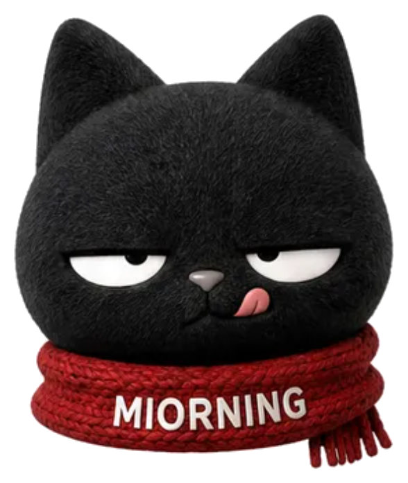
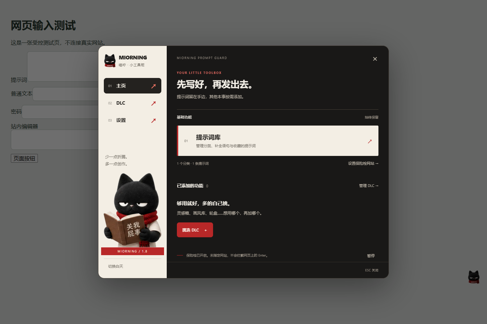
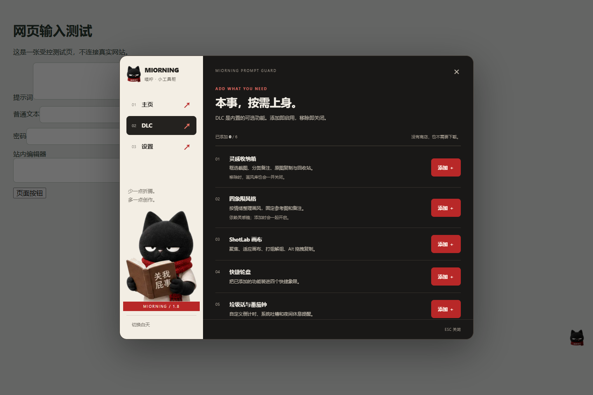
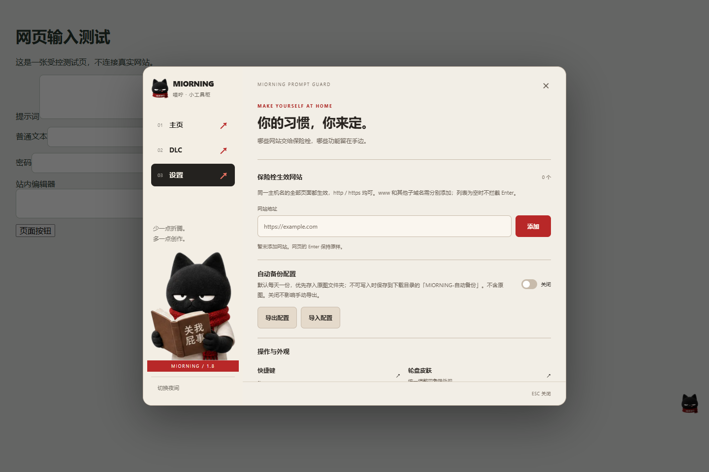
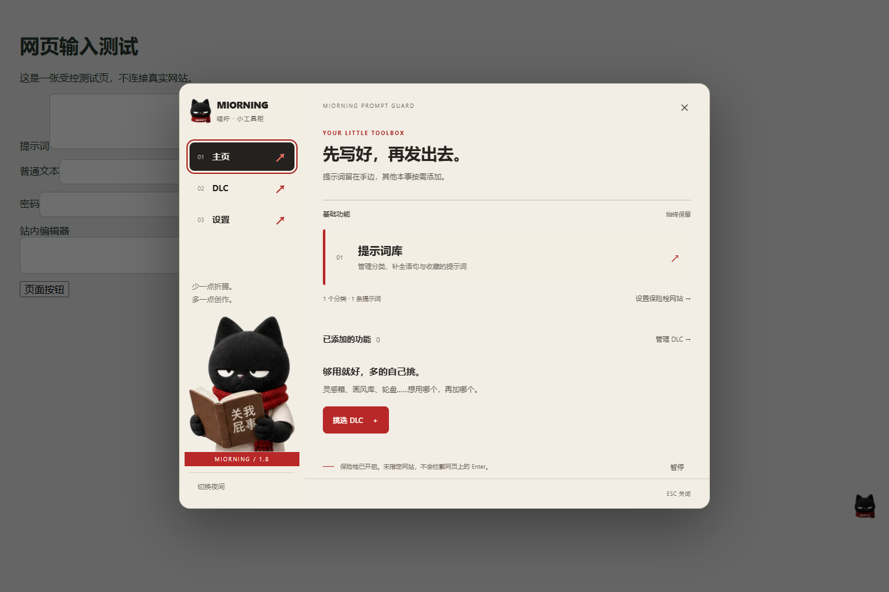

# MIORNING 喵咛

**不想干活，但挺会帮忙。**

给 AI 视频创作者准备的一只黑猫：生成前防手滑，平时收灵感、挑画风、管提示词。需要什么就加什么，不想要的功能让它回柜子里待着。

**[下载 v1.8.0](https://github.com/miorning/miorning-prompt-guard/releases/tag/v1.8.0)** · [English](README.en.md) · [视频教程合集](https://space.bilibili.com/353186187/lists/8624370) · [反馈问题](https://github.com/miorning/miorning-prompt-guard/issues)

> 免费使用，允许用它做商业视频。**不允许售卖插件、收费分发修改版，或把插件功能包装成收费服务。** 本次 v1.8.0 发布采用源码公开许可，见 [LICENSE](LICENSE) / [中文说明](docs/LICENSE.zh-CN.md)。历史 MIT 授权不追溯撤销。

*实际 v1.8.0 界面，拍摄于受控示例页。以下图片不包含个人账号或私有收藏。*

## 这次更新了什么？

本来只想防一次手滑，顺手塞进去的东西越来越多。所以这次，给黑猫收拾了一下家。

- **DLC 模式**：六个可选模块，按需添加、随时停用。功能还在，数据也不删。
- **回车不再到处拦**：只在你亲自添加的网站根网址下启用保险栓。
- **备份有开关了**：每天自动备份默认开启，不需要可以关闭。
- **黑猫接管界面**：奶油白、炭黑、围巾红，日夜两套模式。
- **修了那个黑色小圆点**：处理空提示气泡和网页按钮样式干扰的可复现情况。

## 一个工具柜，六块 DLC

基础功能一直在：**提示词库、网页文字收藏、指定网站的 Enter 确认、配置导入导出、日夜模式和浮标拖动**。

| 可选模块 | 能干什么 |
| --- | --- |
| 灵感收纳箱 | 框选截图、分类备注、缩略图预览、点击复制原图、拖动排序与分类、回收站。 |
| 四象限风格 | 按「正向 / 负向 × 高能量 / 低能量」整理参考图；单图可进多个象限，固定后复制原图或备注。 |
| ShotLab 画布 | F 聚焦、Alt+F 适应画布、G 打组、Alt+G 解组、Alt+左键拖动复制；保留各项开关。 |
| 快捷轮盘 | 把已添加的功能分配到四个方向；经典、少女、酷炫三套轮盘皮肤。 |
| 垃圾话与番茄钟 | 自定义倒计时、最近三次时长、延期提醒；系统吐槽和夜间催睡可单独关闭。 |
| 成就收藏册 | 四条成就线和一点不太正经的彩蛋。并不优秀，但有勋章。 |

*DLC 随包内置，不收费、不远程下载代码。「移除」是停用，不是删除收藏。四象限风格依赖灵感箱。*

全新安装默认只开基础功能；识别到旧版配置时会保留已有功能，你可以再去 DLC 里精简。没有添加的模块不会抢它对应的快捷键。

## 三步开始

1. **装好扩展**：下载 Release 里的 `miorning-prompt-guard-v1.8.0.zip`，解压。Chrome 打开 `chrome://extensions/`，开启开发者模式，点击「加载已解压的扩展程序」，选择**包含 manifest.json 的文件夹**，不要直接选 ZIP。
2. **叫出黑猫**：刷新普通网页，右键网页上的黑猫图标打开工具柜。左键切换保险栓；悬停后用左侧拖动按钮挪位置。
3. **按需配置**：到 DLC 添加想用的模块，再到设置添加保险栓生效的网站。需要存灵感原图时，在灵感箱或浏览器工具栏的扩展按钮中选择并授权文件夹。

其他 Chromium 浏览器可尝试加载；本版检查使用 Chrome，不承诺所有浏览器和网页都适配。浏览器设置页、扩展商店等受限页面不能注入插件。

## 回车保险栓：只管你指定的网站

*管理网站范围与自动备份。此图的备份开关已手动关闭；新安装默认开启。*

在「设置 → 保险栓生效网站」填入根网址，例如 `https://example.com`；粘贴完整画布链接也会自动提取根网址。

- 同一主机名下所有路径都生效，HTTP / HTTPS 均可。
- `www.example.com`、`app.example.com` 等需要分别添加，不支持通配符。
- **列表初始为空，未添加时不会拦截 Enter。** 升级用户也请检查这一项。
- 在支持的文本输入框中，Enter / Ctrl+Enter 触发确认；Shift+Enter 保持换行，输入法组合输入不触发。
- 检查提示词、BGM、字幕、画幅和时长，然后继续生成流程。

这是键盘确认工具，**不保证拦住点击生成按钮、自定义快捷键或所有编辑器**。网站名单只限制 Enter 保险栓，不等于限制其他模块运行范围或缩减扩展的网站访问权限。

## 常用操作

| 默认快捷键 / 操作 | 用途 |
| --- | --- |
| 反引号键（键盘上的 &#96; / ~ 键） | 开关保险栓 |
| Ctrl+B | 收藏网页上选中的文字 |
| Alt+F1 / Alt+F2 | 截图保存灵感 / 打开灵感箱 |
| Alt+反引号（通常称 Alt+~） | 风格四象限 |
| Alt+Q | 快捷轮盘 |
| Alt+T | 垃圾话与番茄钟 |
| Esc | 关闭普通弹窗；番茄钟强提醒使用其自己的确认 / 延期按钮 |
| 鼠标停在黑猫上按 Tab | ShotLab 画布设置，仅在对应画布且添加模块后可用 |

全局快捷键可在设置的「快捷键」窗口里点击后重新录入。若与显卡软件、浏览器或网站冲突，换一组就行。可选模块须先添加对应 DLC；ShotLab 画布快捷键及开关在自己的面板中，Ctrl+V 保持原生。

## 白天上班，晚上也别太拼

提示词、灵感、风格等界面跟随日夜主题。黑猫可以拖走，上下提示会跟着它，并尽量留在网页可视范围内。

## 配置与原图：分开保管

- 配置保存在扩展本地；灵感原图在浏览器数据库或你授权的文件夹中。
- **导出不是原图库**：包含提示词、设置、备注、缩略图、成就进度及原图目录名等，不包含灵感原图。换电脑时要另行复制原图，并重新授权。
- **自动备份默认开启**：浏览器运行时，每个本地自然日一份。优先写入原图目录下的 `MIORNING-自动备份`；不可写入时回退到浏览器下载目录的同名文件夹。电脑或浏览器彻底关闭时不运行。
- **导入会覆盖当前配置与灵感记录，不是合并**。先导出，再导入。
- 备份是**未加密 JSON**，可能含私人提示词和缩略图，请勿上传公开仓库。
- 文件夹授权由浏览器管理，权限失效后可能需重新授权；插件不能强行取得永久硬盘权限。

## 从旧版升级

1. 先在旧版导出配置，另行保留原图文件夹。
2. 将新版文件覆盖到**原先加载扩展的同一个文件夹**。
3. 在扩展管理页点击「重新加载」，再刷新网页。
4. 检查网站名单、DLC 选择和原图目录授权。

**不要先卸载旧版。** 新加载目录可能获得新的扩展 ID，数据不会自动跟过去；这时需手动导入并重新授权。不要同时启用两份插件。

## 权限、隐私与测试

本版没有账号系统、云同步或遥测上传功能。在本地处理提示词、截图与收藏；点击作者和教程链接时会打开外部网站。

申请网页访问、剪贴板、存储、离屏处理、定时任务和下载权限，用于界面注入、复制参考图、保存、图片处理、提醒与备份。**网站名单不替代浏览器权限控制**，请只安装你信任的源码和发布包。

v1.8.0 完成 22 项 Chrome 受控界面检查和 25 项后台逻辑检查。界面检查使用实际内容脚本，但模拟了扩展 API；**不是所有真实网站、硬盘授权、下载及后台生命周期的端到端认证**。详情见 [测试报告](TEST-REPORT.txt)。

## 许可与作者

**可以**：免费使用、修改、免费分享；用插件制作收费视频、接单或在企业内部创作。

**不可以**：售卖插件及修改版、收费下载或把插件功能包装成付费服务。独立的视频创作、课程和咨询不会仅因使用或讲解插件而被禁止。

[MIORNING Community License 1.0](LICENSE) 不是 OSI 意义上的开源许可证。以前按 MIT 获得的版本及代码权利仍然保留，见 [历史 MIT 许可](licenses/LEGACY-MIT.txt)；这不代表新版整包可以任选 MIT。摘要不能替代许可全文。

作者：[Miorning 喵咛](https://space.bilibili.com/353186187) · [教学合集](https://space.bilibili.com/353186187/lists/8624370) · [更新记录](CHANGELOG.md) · [历次发布](https://github.com/miorning/miorning-prompt-guard/releases)

> 少烧一点积分，少犯一点低级错。然后早点滚去睡觉，小崽子。
